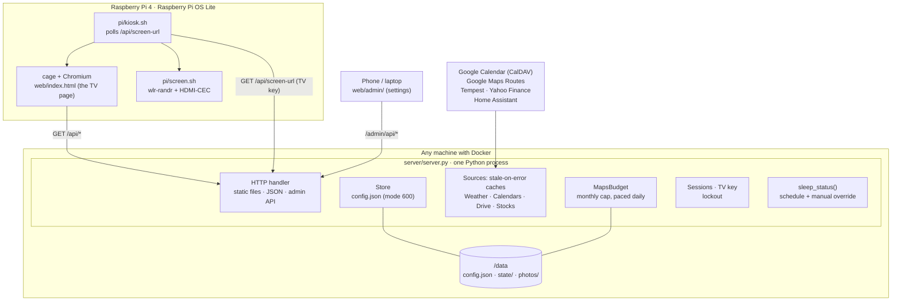

# Architecture

How the pieces fit, for whoever changes it next. For installing and using it, see the [README](README.md).

## The shape of it

## Repository layout

| Path | What it is |
|---|---|
| `server/server.py` | The whole server: settings, auth, the data sources, the HTTP handler |
| `server/test_server.py` | End-to-end tests against fake upstreams (real server, real HTTP) |
| `server/config.seed.example.json` | An example of starting settings; the server uses `config.seed.json` if you add one |
| `web/index.html`, `app.js`, `styles.css` | The TV page: one fixed 1920 × 1080 stage, scaled to the screen |
| `web/demo.js`, `icons.js`, `config.js` | Sample data for `?mode=demo`, weather and place icons, built-in defaults |
| `web/tv/index.html` | Trades a TV key for a cookie, then opens the dashboard |
| `web/admin/` | The settings site: `admin.js` (shell and a few pages) plus `pages-*.js` modules |
| `pi/install-display.sh` | Turns a fresh Raspberry Pi OS Lite into the TV |
| `pi/kiosk.sh`, `screen.sh` | The launcher and the screen on/off helper |
| `pi/install.sh`, `restore.sh`, `kiosk_setup.py` | The older single-Pi installer for DAKboard OS, and the shared patching code |
| `tools/backup-sd-card.sh` | Makes a compressed image of the TV's SD card on a Mac |
| `compose.yaml`, `Dockerfile` | The server stack; `compose.pi.yaml` is only for the older single-Pi setup |

## The server (`server/server.py`)

Standard-library `ThreadingHTTPServer`; the packages are `icalendar`, `recurring-ical-events` and `yfinance` (which brings pandas and numpy, so the container gets 512 MB). There is no database: state is one JSON file plus a few files in a data folder.

| Piece | Job |
|---|---|
| `Store` | Loads and atomically saves `config.json`; bumps a **version** the TV watches (a quiet save, used for the sleep schedule, doesn't) |
| `apply_settings()` | The only way settings change: validates a patch (`_str`, `_int`, `_choice`, `_layout`, `_schedule_rules`, …) and returns a new config or raises `ValueError` |
| `public_settings()` | What the settings site sees: every secret replaced by "set or not" |
| `Source` | A cache with *stale on error* and a 60 s back-off; one per data feed |
| `HomeAssistant` | Reads Home Assistant's REST API with a token the server keeps: status tiles (`ha_describe()` decides the wording and colour), which cameras have motion, and still pictures from the chosen cameras |
| `Weather`, `Calendars`, `Drive`, `Stocks` | Fetch and normalise Tempest, CalDAV/iCal, Google Routes and Yahoo Finance (through the `yfinance` package) |
| `MapsBudget` | Counts Google Maps reads on disk; each day may use what's left divided by the days left in the month |
| `merge_copies()` | One event per thing: copies with the same title, start and end become one, listing every calendar |
| `sleep_status()` | Whether the screen should be asleep now (weekday rules, overnight spans, manual override), and until when |
| `Sessions` | Settings sign-in sessions and the failed-attempt lockout |
| `App` | Wires it together; owns the TV key, the sleep override, the backup and the stock search |
| `make_handler()` | Routing: static files, `/api/*`, `/admin/api/*`, `/healthz`, `/api/tv/pair` |

### Who may call what

| Caller | Gets |
|---|---|
| The same machine (only when **not** in `DASHBOARD_OFFSITE=1` mode) | The data feeds and `/api/screen-url` |
| A TV with the **TV key** (`Authorization: Bearer`, or the `fd_tv` cookie) | The same |
| A signed-in settings session (`fd_session` cookie) | The data feeds, and everything under `/admin/api/` |
| Anyone on the network | The data feeds, only if "Others can view" is on |

Every state-changing call also needs the header `X-Dashboard: 1`, which another site can't send without a pre-flight request the server never answers.

### Endpoints

| Endpoint | Returns |
|---|---|
| `GET /api/weather` · `calendar` · `drive` · `stocks` | The cached feeds, with `stale`/`error` when an upstream is failing |
| `GET /api/home` · `cameras` · `/api/ha/camera/<id>.jpg` | Home Assistant tiles, which cameras have motion, and a camera still. **TV or settings session only**: never offered through "Others can view" |
| `GET /api/route?to=…&arrive=…` | One trip with traffic detail, for a "Leave by" time |
| `GET /api/config` | The display settings the TV needs (no secrets), including `layout` |
| `GET /api/version` | A number that changes when settings are saved; the TV reloads on change |
| `GET /api/screen-url` | Three lines: the page to show, a "reload" counter, `asleep` or `awake` |
| `GET /healthz` | Per-source health, the Maps counter and the TV's last frame rate |
| `POST /admin/api/settings` | A settings patch (validated by `apply_settings`) |
| `GET /admin/api/status` · `settings` · `stocks/search` · `ha/entities` · `backup` | Admin-only reads |
| `POST /admin/api/screen/sleep` · `screen/reload` · `tv/key` · `calendar/refresh` | Admin-only actions |

### Settings (`config.json`)

Top-level keys: `timezone`, `home`, `tempest`, `calendar` (account and calendars), `drive` (key, places, monthly limit), `stocks`, `display` (look, background, dimming), `photos`, `screen` (what the TV shows), `schedule` (sleep rules), `layout` (widget boxes, or `null` for the built-in arrangement), `ha` (Home Assistant: address, token, chosen tiles and cameras, pop-up settings), `tv` (the TV key's hash) and `admin` (the password hash). `DEFAULT_CONFIG` in `server.py` is the reference.

## The TV page (`web/app.js`)

- One `stage` of 1920 × 1080 CSS pixels, scaled to the screen. Eight widgets: `clock`, `weather`, `drive`, `calendar`, `focus` (the Today panel), `ticker`, and the two Home Assistant ones, `home` (the status strip) and `camera`. The motion pop-up is not a layout widget: it covers the screen whenever the server says a camera is active.
- **Free layout.** If `layout` is set, each widget is placed absolutely from its box. Widgets with a fixed design scale their contents with CSS `zoom`; the calendar and Today panel keep their text size and fit more or fewer days instead. The settings site previews edits by `postMessage` to a frame running this same page.
- **Backgrounds.** `sky` (palettes by sunrise, sunset and weather), `photos`, `photo`, `gradient`, `color`; the *appearance* setting pins light or dark.
- **Resilience.** Each feed renders from its last good data and says how old it is. The page measures its own frame rate, reports it, and turns the glass blur off by itself if it can't keep up.
- **Performance rules learned the hard way:** never animate a full-screen background colour (it repaints the whole screen every frame), keep the animated ticker in its own layer, and run the Pi's video at 1080p.

## The settings site (`web/admin/`)

Plain JavaScript, no build step. `admin.js` is the shell (sign-in, routing, Simple/Expert mode, a few pages); `pages-schedule.js`, `pages-look.js`, `pages-layout.js` and `pages-ops.js` register pages in `FD.pages` and use helpers shared through the `FD` object. Pages marked expert are hidden, and redirected away from, while Simple mode is on.

## The TV (`pi/`)

`family-tv.service` runs `cage -- pi/kiosk.sh`. The launcher sources `data/kiosk.env` (the browser command, the server address and the TV key), asks the server what to show, opens Chromium on it, and polls every five seconds. When the first two lines of the answer change it restarts the browser. The third line drives `screen.sh`, which switches the HDMI output (`wlr-randr`) and the TV (HDMI-CEC, `cec-ctl`); the launcher re-checks every 30 seconds so a stray wake can't stick. If the server never answers, the launcher opens the fallback link it was installed with.

## Testing

`server/test_server.py` starts the real server against fake Tempest, CalDAV, Routes and Home Assistant servers (and a stand-in for `yfinance`) and exercises it over HTTP. `pi/test_kiosk_setup.py` tests the installer's patching and the launcher's functions (sourced with `KIOSK_LIB_ONLY=1`) against stand-in commands.
