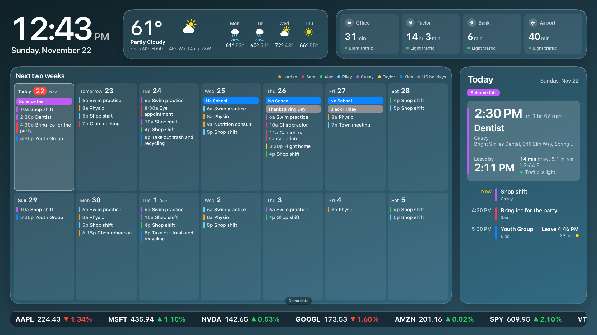
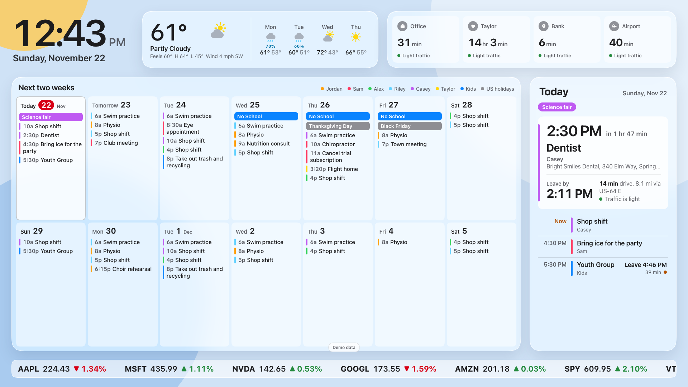
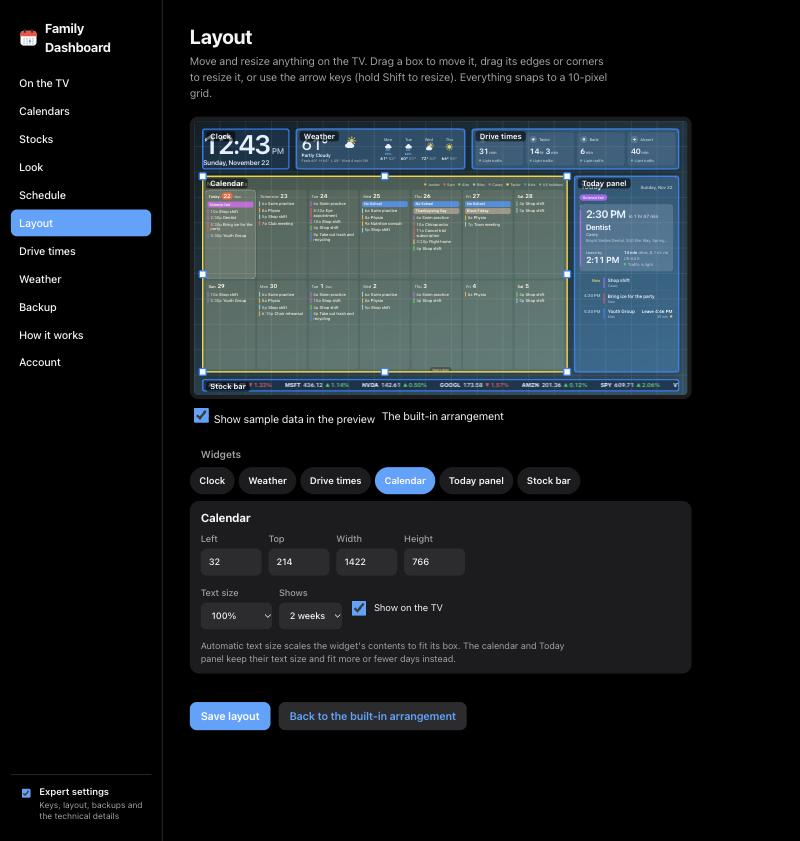
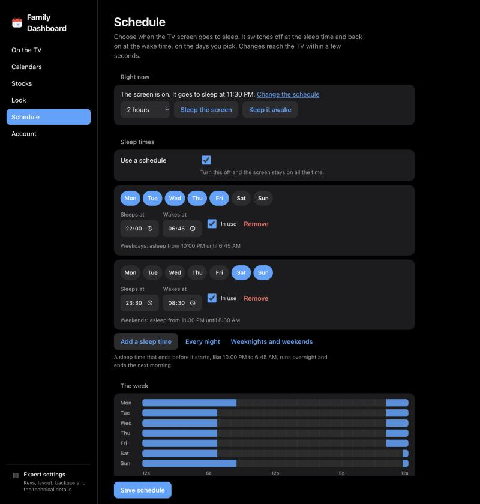
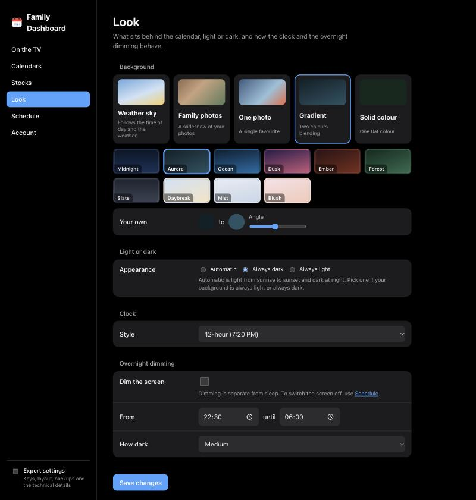
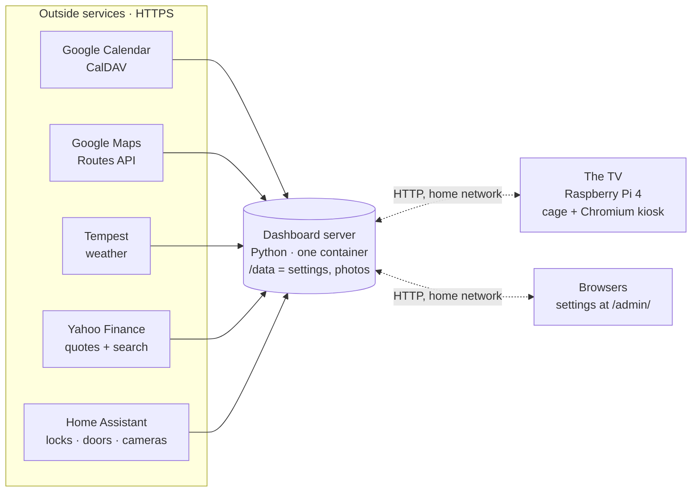

<div align="center">


# Family Dashboard

**A calendar-first screen for the living-room TV, and settings anyone in the house can use from a phone.**


<br>



<sub>Everything on screen above is sample data for a made-up family.</sub>

</div>

<br>

## What it is

A Raspberry Pi drives a TV in the common room. It shows the next two weeks from every calendar in one Google account, when to leave for the next appointment, the weather from a backyard station, always-on drive times and a scrolling stock bar. A small server keeps every key private, does the fetching and serves a settings site that works on a phone.

It started as a replacement for a hosted dashboard service, so it keeps that service available as a fallback: if the server is ever unreachable, the TV shows the old screen again on its own.

<table>
<tr>
<td width="50%"></td>
<td width="50%"></td>
</tr>
<tr>
<td align="center"><sub>Light by day, dark by night, or pinned either way</sub></td>
<td align="center"><sub>Move and resize anything, with a live preview</sub></td>
</tr>
</table>

## Features

**On the TV**
- 📅 **The next one to four weeks** of every calendar in a Google account, each in its own colour. An event copied to several calendars (a chore on everyone's list) shows **once**, striped in each calendar's colour.
- 🚗 **When to leave.** The next event with an address shows the drive time, current traffic and a "Leave by" time. Later events get their own on the right.
- 🏠 **Drive times** to four places that matter, always on screen, inside a **monthly Google Maps budget** (900 reads by default, spread evenly through the month so a busy morning can't use the rest of it).
- 🌦 **Weather** from a Tempest station, with the next four days, and a **sky** that follows the real weather and the time of day.
- 📈 **A stock bar** that never stops sliding: prices in green and red with the percent change, for the tickers you choose. Stocks, ETFs, mutual funds, indexes and crypto, from Yahoo Finance, with no account or key.
- 🔒 **Smart home** (Home Assistant): lock, door, garage, alarm and who's-home tiles with an "All secure" summary and warnings when something has been left open, lights, thermostats and sensors if you want them, a camera tile, a four-camera wall, and a pop-up that covers the screen when a camera sees motion.
- 🖼 **Backgrounds**: the weather sky, family photos, one photo, ten gradients, or a flat colour. Light, dark or automatic by sunrise and sunset.
- 🧩 **A free layout**: drag the clock, resize the calendar, hide what you don't need.
- 🌙 **Sleep schedules** by day of the week: the screen (and the TV, over HDMI-CEC) switches off and on by itself, with a one-click "sleep now" or "keep awake".

**In the settings** (`/admin/`)
- **Simple and Expert modes.** Simple shows what the family needs: what's on the TV, calendars, stocks (with a company-name lookup), the look, and the schedule. A switch at the bottom of the menu adds keys, layout, backups and the technical details.
- A **Backup & recovery** page, and a **How it works** page written for whoever looks after it.

<table>
<tr>
<td width="50%"></td>
<td width="50%"></td>
</tr>
</table>

## How it fits together



- **The server** is one small Python process (standard library plus three packages: two for calendars, one for stock prices). It holds every key and the only copy of the settings.
- **The TV** only shows a web page. A launcher script asks the server every few seconds which page to show and whether the screen should be asleep. Nothing on the Pi is irreplaceable.

More detail, including the API and the data model, is in [ARCHITECTURE.md](ARCHITECTURE.md).

## Quick start

You need a machine with Docker for the server (a NAS, a spare PC, a home server) and a Raspberry Pi 4 for the TV.

### 1 · Run the server

```bash
git clone https://github.com/gklier/kliercalendar.git
cd kliercalendar
mkdir data && sudo chown -R 1000:1000 data     # the container runs as user 1000
docker compose up -d --build
```

Open `http://<server>:8080/admin/` and create the settings password.

<details>
<summary><b>Using Portainer</b></summary>

**Stacks → Add stack → Repository.** Point it at this repository, set the compose path to `compose.yaml`, and add the environment variables `DATA_DIR` (a folder on the host, owned by user 1000) and `TZ`. **Pull and redeploy** updates it later. The data folder is never touched by an update.

</details>

### 2 · Connect your accounts

In the settings, with **Expert settings** switched on:

| Page | What to add | Where to get it |
|---|---|---|
| **Calendars** | The Google account's email and an **app password** | [myaccount.google.com/apppasswords](https://myaccount.google.com/apppasswords) (the account needs 2-Step Verification) |
| **Weather** | Station ID and access token | [tempestwx.com](https://tempestwx.com) |
| **Drive times** | A Google Maps **Routes API** key and the addresses | [console.cloud.google.com](https://console.cloud.google.com) |
| **Smart home** | Home Assistant's address and a long-lived access token | In Home Assistant: your profile, Security, Long-lived access tokens. See [docs/home-assistant.md](docs/home-assistant.md) |
| **Stocks** | Just tickers: no key | Look them up by name on the page. Prices come from Yahoo Finance through the [yfinance](https://pypi.org/project/yfinance/) package |

Keys are stored on the server only and are never shown again, in the browser or in the logs. (Stock prices need none.)

### 3 · Set up the TV

Write **Raspberry Pi OS Lite (64-bit)** to a card with Raspberry Pi Imager (set a hostname, a user, Wi-Fi and SSH). In the settings, open **Backup** and **Make a TV key**, then on the Pi:

```bash
git clone https://github.com/gklier/kliercalendar.git
cd kliercalendar
sudo DASHBOARD_SERVER=http://<server>:8080 DASHBOARD_TV_KEY=<the key> ./pi/install-display.sh
sudo reboot
```

The installer sets up a full-screen Chromium inside [cage](https://github.com/cage-kiosk/cage) (no desktop), starts it at boot, sets the video output to 1080p at 60 Hz (a Pi 4 animates far more smoothly than at 4K), turns off Wi-Fi power saving, and hands the sleep schedule to the server. If the server can't be reached, the TV shows a waiting page and keeps trying.

## Using it

| Page | For |
|---|---|
| **On the TV** | Switch between the family dashboard and the fallback screen, reload the TV |
| **Calendars** | Rename, recolour and switch calendars on or off |
| **Stocks** | Look companies up by name and build the bar |
| **Smart home** | Choose the lock, door and alarm tiles and the cameras; pop-up settings |
| **Look** | Background, light or dark, clock style, overnight dimming |
| **Schedule** | When the screen sleeps, by day; sleep now or keep awake |
| *Layout* | Move and resize every widget |
| *Drive times, Weather* | Addresses, keys and the Maps limit |
| *Backup* | Download the server's data; rebuild the TV if its card dies |
| *How it works* | The technical picture, live from the running server |

*Italic pages appear when Expert settings is on.*

## Security and privacy

- One settings password, stored as a salted PBKDF2-SHA256 hash. Sessions are `HttpOnly`, `SameSite=Strict` cookies; repeated wrong passwords lock sign-in for five minutes.
- Changes need a custom header a web page on another site can't send.
- The data feeds are open only to a signed-in settings session, a TV carrying its **TV key**, or (if you switch it on) the home network. Lock states and camera pictures are never offered to the home network: only the TV or a settings session sees them.
- Secrets never leave the server, and the settings file is readable only by its owner.
- It speaks plain HTTP, meant for a trusted home network. Put any reverse proxy in front for HTTPS; cookies turn `Secure` by themselves.
- Use a dedicated Google account, or share the calendars read-only with one. An app password can reach more than calendars; revoke it from the Google account page to cut the dashboard off at once.

## Backups and recovery

The server's data folder is the only thing that can't be recreated. The **Backup** page downloads it as one file, and shows how to automate that. The TV is rebuilt in about ten minutes from a fresh card with the command above, or restored from an image made with [`tools/backup-sd-card.sh`](tools/backup-sd-card.sh).

## Built-in assistant (optional)

**Settings → Assistant** (Expert) is a chat with Claude about the dashboard's own code. It keeps one conversation and one memory file on the server, so every device sees the same history and context. It only proposes: it edits a copy of the code and runs the tests, you look at the change, and **Apply** runs the tests again, commits, and builds a new image. Nothing reaches the TV until you update the stack.

It runs in its own container with no Docker access. A small helper on the host builds the image from the exact commit you approved.

1. On the Docker host, from the project folder:
   ```bash
   docker build -t family-dashboard-assistant:latest -f assistant/Dockerfile .
   sudo DATA_DIR=/path/to/dashboard-data ASSISTANT_DIR=/path/to/assistant-home ./assistant/host/install-host.sh
   ```
2. Add the service in [`assistant/compose.snippet.yaml`](assistant/compose.snippet.yaml) to the stack, with your folder, and redeploy.
3. Sign in once with your Claude account: `docker exec -it family-dashboard-assistant claude`, then `/login`.
4. Optional: put notes about your setup in `ASSISTANT_DIR/.claude/CLAUDE.md`. That is the assistant's memory; it stays on the server.

## Power cuts and internet outages

Built to ride them out without anyone touching it.

- **Internet gone:** the TV needs only the home network and the server, so it keeps showing the last good information with small "offline since" notes, and refreshes by itself when the internet is back.
- **Power gone:** everything starts again by itself. The TV waits for the network, then opens the dashboard.
- **Router slower than the Pi:** a watchdog on the Pi keeps retrying the Wi-Fi, asks for the saved connection again, restarts the network service, and as a last resort restarts the Pi (at most once an hour, and only when the *router* can't be reached, never for an internet outage). The launcher reopens the dashboard once the server is back, so the browser's own "no internet" page can't stay up.
- **No clock after a power cut:** a Pi can't keep time while unplugged, so the TV page takes the time from the server.
- **Help for every case** is on the **Help** page of the settings, in plain steps.

To put the latest TV software on an installed Pi, run `git pull && sudo ./pi/install-display.sh && sudo reboot` in the project folder on it. It keeps the address and key it has.

## Development

```bash
python3 -m venv venv && venv/bin/pip install -r server/requirements.txt

# Run the server locally with sample settings
mkdir -p /tmp/fd/state
venv/bin/python server/server.py --config /tmp/fd/config.json --state-dir /tmp/fd/state --port 8080
#   TV: http://localhost:8080/?mode=demo        Settings: http://localhost:8080/admin/

# Tests
cd server && ../venv/bin/python -m unittest test_server.py
cd server && ../venv/bin/python -m unittest test_chaos.py      # hostile input, lying services, damaged data (about 30 s)
cd pi && python3 -m unittest test_kiosk_setup.py
```

The TV page also runs from any static file server (`cd web && python3 -m http.server`, then `?mode=demo`).

```
server/    Python server and its tests, plus an example starting config
web/       The TV page, and web/admin/ for the settings site
pi/        Installers, the TV launcher, screen on/off, restore
tools/     Helper scripts (SD-card image backup)
docs/      Screenshots and design notes
```

## Ideas on the list

See [docs/ROADMAP.md](docs/ROADMAP.md) for what could come next, and the last section of [docs/home-assistant.md](docs/home-assistant.md) for smart-home ideas.

<div align="center"><br><sub>A family project, shared as it is.</sub></div>
